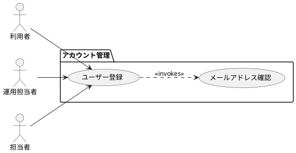

# UC-001: ユーザー登録

## ユースケース基本情報

| 項目 | 内容 |
| :--- | :--- |
| ユースケース名 | ユーザー登録 |
| 概要 | 利用者が新しいアカウントを登録する。 |
| パッケージ | アカウント管理 |
| 関連要求ID | REQ-001, REQ-002 |

## アクター

| アクター | 役割・説明 |
| :--- | :--- |
| 利用者 | アカウントを登録する。 |
| 運用担当者 | 登録状況を確認する。 |
| 担当者 | 登録状況を確認する。 |

## 条件

| 条件種別 | 条件 |
| :--- | :--- |
| 事前条件 | 利用者が登録画面を表示している。 |
| 事前条件 | 利用者が有効なメールアドレスを保有している。 |
| 事後条件 | アカウントが登録されている。 |
| 事後条件 | 確認メールが送信されている。 |

## トリガー

| トリガー |
| :--- |
| 利用者が新規登録を選択する。 |
| 招待メール内の登録リンクを開く。 |

## メインフロー

### シナリオ1

1. 利用者は登録情報を入力する。 2. 利用者は登録を確定する。 
### シナリオ2

1. システムは入力内容を検証する。 2. システムはアカウントを登録する。 
#### シナリオ2-1

1. システムはメールアドレスの重複を検出する。 2. システムはエラーを表示する。 
#### シナリオ2-2

1. システムは入力形式の誤りを検出する。 2. システムは該当項目を示す。 
### シナリオ3

システムは登録完了を通知する。

## 代替フロー

### シナリオ1

**発生条件:** メールアドレスがすでに登録されている

1. システムは重複エラーを表示する。 2. 利用者は別のメールアドレスを入力する。 
#### シナリオ1-1

**発生条件:** 利用者が入力を修正して再送信する

システムは修正内容を検証し、メインフローへ戻る。

## ユースケース図（PlantUML）

